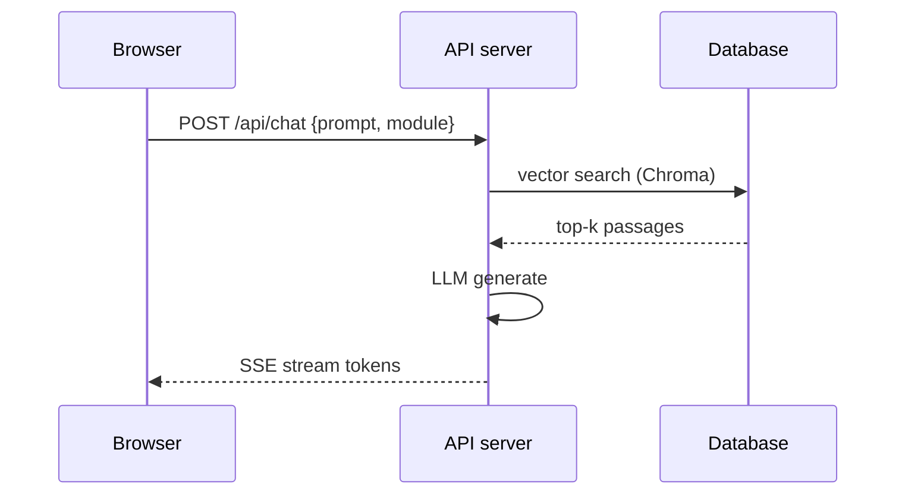

# COU 07503 / COU 07501 — Web App Development / Cybersecurity

## 1. Web architecture
Client (HTML/CSS/JS) ↔ HTTP(S) ↔ App server (REST API) ↔ Database. Stateless REST: GET/POST/PUT/PATCH/DELETE with status codes 200/201/400/401/403/404/500.



## 2. Frontend essentials
- Semantic HTML, Flexbox/Grid, responsive breakpoints, accessibility (labels, contrast, focus).
- React: components, props, `useState`/`useEffect`, lifting state; `fetch` + `EventSource` for SSE.

```js
const res = await fetch("http://localhost:8000/api/chat-sync", {
  method: "POST",
  headers: { "Content-Type": "application/json" },
  body: JSON.stringify({ prompt, module })
});
```

## 3. Backend essentials
- FastAPI path operations, Pydantic validation, CORS, status codes, SSE via `StreamingResponse`.
- Auth: passwords hashed with bcrypt/argon2; sessions via signed JWT (short expiry + refresh); never store secrets in code.

```python
from fastapi import FastAPI
app = FastAPI()

@app.post("/api/chat-sync")
def chat_sync(req: ChatRequest):
    return {"answer": "...", "sources": []}
```

## 4. OWASP Top 10 ( essentials)

| Risk | Example | Fix |
|---|---|---|
| Injection (SQLi) | `' OR '1'='1` | Parameterised queries / ORM |
| XSS | `<script>` in comments | Escape output, CSP |
| Broken auth | Predictable session IDs | MFA, secure cookies, rate limits |
| Sensitive data exposure | HTTP + plaintext secrets | TLS, env vars, encryption at rest |
| SSRF / XXE | Fetching internal URLs | Allow-lists, disable external entities |
| Misconfiguration | Debug on, default creds | Hardened baselines, scanners |

## 5. Crypto & network basics
- CIA triad; hashing (SHA-256/bcrypt) vs encryption (AES-256-GCM) vs signatures (RSA/ECDSA).
- TLS handshake gives confidentiality + integrity; Diffie-Hellman establishes shared secrets.
- Hashing a password: `bcrypt.hashpw(pw, bcrypt.gensalt(rounds=12))`.

## 6. Solved problem
Fix reflected XSS in a search page: escape `q` before injecting into HTML (`textContent` instead of `innerHTML`) and add `Content-Security-Policy: default-src 'self'`.
