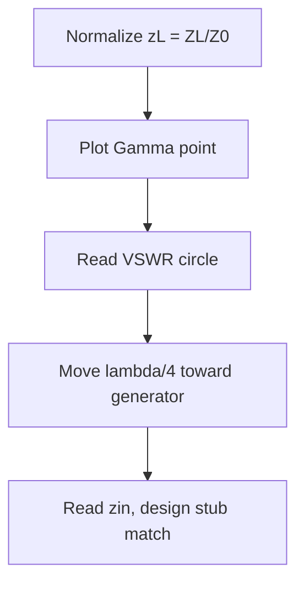

# ETU 07522 — Engineering Electromagnetics

## 1. Vector calculus essentials
- Gradient $\nabla V$, divergence $\nabla\cdot\mathbf{D}$, curl $\nabla\times\mathbf{H}$.
- Divergence theorem: $\oint_S \mathbf{D}\cdot d\mathbf{S} = \int_V \nabla\cdot\mathbf{D}\,dv$.
- Stokes: $\oint_L \mathbf{E}\cdot d\mathbf{l} = \int_S (\nabla\times\mathbf{E})\cdot d\mathbf{S}$.

## 2. Maxwell's equations

| # | Differential | Integral | Meaning |
|---|---|---|---|
| 1 | $\nabla\cdot\mathbf{D}=\rho_v$ | $\oint\mathbf{D}\cdot d\mathbf{S}=Q$ | Gauss electric |
| 2 | $\nabla\cdot\mathbf{B}=0$ | $\oint\mathbf{B}\cdot d\mathbf{S}=0$ | No magnetic monopole |
| 3 | $\nabla\times\mathbf{E}=-\partial\mathbf{B}/\partial t$ | $\oint\mathbf{E}\cdot d\mathbf{l}=-d\Phi/dt$ | Faraday |
| 4 | $\nabla\times\mathbf{H}=\mathbf{J}+\partial\mathbf{D}/\partial t$ | Ampere-Maxwell | Magnetism from current + displacement |

Constitutive: $\mathbf{D}=\varepsilon\mathbf{E}$, $\mathbf{B}=\mu\mathbf{H}$, $\mathbf{J}=\sigma\mathbf{E}$.

## 3. Plane waves
Wave equation: $\nabla^2\mathbf{E} - \mu\varepsilon\,\partial^2\mathbf{E}/\partial t^2 = 0$.
- Speed $u = 1/\sqrt{\mu\varepsilon}$ ($c \approx 3\times10^8$ m/s in free space).
- Intrinsic impedance $\eta = \sqrt{\mu/\varepsilon} \approx 377\,\Omega$.
- Skin depth $\delta = \sqrt{2/(\omega\mu\sigma)}$; e.g. copper at 1 MHz $\delta \approx 65\,\mu\mathrm{m}$.

## 4. Transmission lines
Telegrapher: $-\partial V/\partial z = (R+j\omega L)I$, $-\partial I/\partial z = (G+j\omega C)V$.
- $\gamma = \alpha + j\beta = \sqrt{(R+j\omega L)(G+j\omega C)}$, $Z_0 = \sqrt{(R+j\omega L)/(G+j\omega C)}$.
- Reflection $\Gamma = (Z_L - Z_0)/(Z_L + Z_0)$, VSWR $= (1+|\Gamma|)/(1-|\Gamma|)$.
- Quarter-wave ($\lambda/4$) line inverts normalised impedance: $Z_{in} = Z_0^2/Z_L$.

| Load | $\Gamma$ | Behaviour |
|---|---|---|
| Matched $Z_L=Z_0$ | 0 | No reflection |
| Short $Z_L=0$ | $-1$ | Full inversion |
| Open $Z_L\to\infty$ | $+1$ | Full in-phase |

## 5. Solved problem
50-Ω line, $Z_L = 100\,\Omega$: $\Gamma = (100-50)/(100+50) = 1/3$, VSWR $= (1+1/3)/(1-1/3) = 2$. Reflected power $|\Gamma|^2 = 1/9 \approx 11\%$.

## 6. Smith-chart flow

