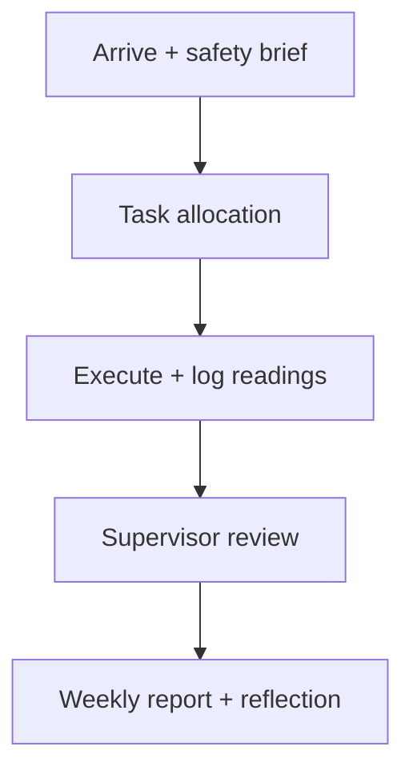

# ETU 07523 — Industrial Practical Training (IPT)

## 1. Purpose & outcomes
- Bridge theory ↔ industry: telecom sites, broadcast stations, power utilities, ICT firms.
- Outcomes: safety culture, instrumentation fluency, teamwork, report writing, ethics.

## 2. Safety first
- PPE: helmet, boots, hi-vis, gloves, harness above 2 m.
- LOTO (lock-out/tag-out) before touching panels; test-before-touch with CAT III/IV meter.
- RF safety: respect exclusion zones near high-gain microwave dishes and BTS antennas.

## 3. Common instruments

| Instrument | Measures | Key spec to note |
|---|---|---|
| DMM | V, I, R, continuity | CAT rating, burden voltage |
| Oscilloscope | Waveforms, rise time | Bandwidth ≥ 5× signal freq |
| Spectrum analyser | Occupied BW, harmonics | RBW/VBW, DANL |
| OTDR | Fibre faults, distance | Dead zone, dynamic range |
| Earth tester | Ground resistance | Target < 5 Ω (telecom sites) |

## 4. Logbook & report structure
1. Title page + station details + supervisor sign-off.
2. Daily log table: date | task | tools | observation | learning.
3. Weekly summary + labelled photos/schematics.
4. Final chapter: problem solved, skills matrix, recommendations.

| Week | Focus example |
|---|---|
| 1–2 | Orientation, safety, tools |
| 3–6 | Supervised tasks (installs, measurements) |
| 7–8 | Mini-project + report + presentation |

## 5. Professionalism
- 5S workplace (sort, set, shine, standardise, sustain), punctuality, NDA/permission before photos.
- STAR technique for viva: Situation → Task → Action → Result, with numbers (e.g. "cut VSWR from 1.8 to 1.2").

